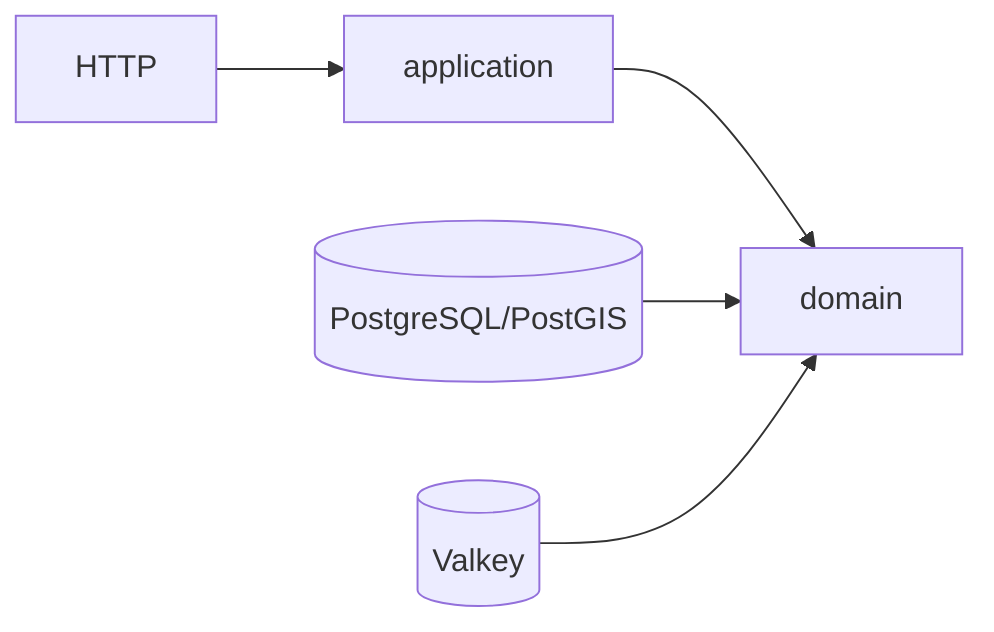

# 🛒 Walmart Chile · API de reserva de ventanas de despacho

> Elige tu dirección, mira qué días y horarios hay y reserva una ventana de despacho,
> **sin que dos personas puedan quedarse con el último cupo**.

API en **Spring Boot 4.1 / Java 21** que resuelve *dirección → comuna → zona → fechas y bloques → reserva* y
garantiza, incluso con cientos de clientes a la vez, que nunca se venda más capacidad de la que existe.

| 🧱 Pieza | Rol |
|---|---|
| **PostgreSQL 17 + PostGIS** | Fuente de verdad: guarda la capacidad y decide quién se queda con cada cupo |
| **Valkey** | Acelerador de lecturas; si se cae, la API sigue siendo correcta |
| **OpenAPI 3.1** | Contrato versionado (Swagger UI incluido) |

**Ir a:** [🚀 Inicio rápido](#-inicio-rápido) · [👀 Pruébala](#-pruébala-en-2-minutos) · [🧪 Pruebas](#-pruebas-y-carga) ·
[🏛️ Arquitectura](#️-arquitectura-en-una-mirada) · [❓ FAQ](#-preguntas-frecuentes) · [📚 Más documentación](#-más-documentación)

---

## 📋 Requisitos

| Herramienta | Versión | Para qué | Comprobar |
|---|---|---|---|
| 🐳 Docker con Compose | Engine API ≥ 1.44 | Levantar la API y la prueba de carga | `docker --version` |
| ☕ Java (JDK) | 21 | Solo para `./mvnw verify` y desarrollo | `java -version` |

No necesitas Maven (el repo trae `./mvnw`).

> 🐳 **¿`docker compose` o `docker-compose`?** Según cómo instalaste Docker (Docker Desktop, Colima, Homebrew) el
> comando se llama distinto. Comprueba cuál tienes:
>
> | Si esto funciona… | Usa en toda la guía |
> |---|---|
> | `docker compose version` | `docker compose …` |
> | `docker-compose version` | `docker-compose …` (con guion) |
>
> Los comandos de este README usan `docker compose`; si tienes el otro, solo cambia el espacio por un guion.
Funciona en Apple Silicon (arm64) y en Intel/AMD (amd64).

---

## 🚀 Inicio rápido

> ⏱️ Primera vez: **3–8 minutos** (descarga y compilación). Después, segundos.

```bash
# 1. Clona y entra
git clone https://github.com/hugo-inda-toledo/walmart-cl-slot-reservation-api.git
cd walmart-cl-slot-reservation-api

# 2. Levanta PostgreSQL + Valkey + API (espera a que estén sanos)
docker compose up --build -d --wait   # si dice "unknown flag: --build", usa: docker-compose up --build -d --wait

# 3. Prueba de humo: debe imprimir líneas "OK"
./scripts/smoke-local.sh
```

Listo ✅. Abre **http://localhost:8080/swagger-ui.html** para probar la API con clics.

| 🔗 URL | Qué es |
|---|---|
| http://localhost:8080/swagger-ui.html | Swagger UI |
| http://localhost:8080/openapi/openapi.yml | Contrato OpenAPI |
| http://localhost:8080/actuator/health/readiness | Estado (`{"status":"UP",...}`) |
| http://localhost:8081 | Web de reserva ([repo web](https://github.com/hugo-inda-toledo/walmart-cl-slot-reservation-website)) |

| Quiero… | Comando |
|---|---|
| Detener y **conservar** datos | `docker compose down` |
| Empezar **desde cero** | `docker compose down -v && docker compose up --build -d --wait` |
| Ver logs de la API | `docker compose logs -f api` |

---

## 👀 Pruébala en 2 minutos

Con el stack arriba, en una terminal:

```bash
BASE_URL=http://localhost:8080

# 📍 Direcciones de demo
curl -s "$BASE_URL/api/v1/demo-addresses"

# 🗓️ Fechas con cupo para Santiago Centro (busca "status":"AVAILABLE")
curl -s "$BASE_URL/api/v1/delivery-dates?comunaCode=13101&latitude=-33.4372&longitude=-70.6450"

# 🈵 La Serena tiene una fecha agotada (busca "status":"SOLD_OUT")
curl -s "$BASE_URL/api/v1/delivery-dates?comunaCode=04101&latitude=-29.9045&longitude=-71.2489"
```

Para el flujo completo — **retener → confirmar → ventana llena (`SLOT_FULL`) → sin cobertura** — sigue el
[🔬 recorrido con curl paso a paso](docs/recorrido-curl.md), con el resultado esperado en cada paso.

---

## 🧪 Pruebas y carga

| Alcance | Comando | Resultado esperado |
|---|---|---|
| Todo (unitarias + integración) | `./mvnw verify` | BUILD SUCCESS (integración con Testcontainers, sin `docker compose`) |
| Solo unitarias | `./mvnw test` | verde |
| Concurrencia | `./mvnw verify -Dit.test=CapacityRaceIT` | sin sobre-reserva |
| Venta relámpago (k6, 300 usuarios) | `./load/run-flash-sale.sh` | `OK venta relámpago` y 0 ventanas sobre capacidad |

Una ejecución real de la venta relámpago (macOS arm64, 2026-10-13):

| Usuarios | Cupo inicial | Retenciones | Confirmaciones | `SLOT_FULL` | p95 | Sobre capacidad |
|---:|---:|---:|---:|---:|---:|---:|
| 300 | 20 | 20 | 20 | 280 | 1430 ms | **0** |

300 clientes pelean por 20 cupos: exactamente 20 ganan y 280 reciben `SLOT_FULL`. Detalle y más comandos en
[🧪 pruebas y carga](docs/pruebas-y-carga.md).

---

## 🏛️ Arquitectura en una mirada



**Decisiones clave**
- **PostgreSQL es la única fuente de verdad** de la capacidad: un `UPDATE` condicional atómico respaldado por `CHECK`.
- **Holds persistentes** con expiración calculada por la base, no TTL en caché.
- **`Idempotency-Key` en la misma transacción** que la reserva: reintentar nunca duplica.
- **Valkey solo acelera**: si cae, la corrección no cambia.
- **Contrato primero** (OpenAPI) y arquitectura hexagonal vigilada con ArchUnit.

Más: [arquitectura y diagramas](docs/arquitectura.md) ·
[concurrencia en producción](docs/concurrencia-en-produccion.md) · [índice de ADRs](docs/adr/README.md).

---

## ❓ Preguntas frecuentes

<details><summary><b>¿Cuánto demora y qué hago si <code>--wait</code> falla?</b></summary>

La primera vez 3–8 minutos. Si falla, revisa `docker compose logs api`. Si no aparece una fecha `SOLD_OUT`,
confirma que `APP_CATALOG_DEMO_ENABLED=true`.
</details>

<details><summary><b>El puerto 8080 (u otro) está ocupado</b></summary>

Mira quién lo usa con `lsof -i :8080` y detenlo, o cambia `API_PORT` en `.env`. Si corres `spring-boot:run`,
detén antes el servicio `api` (`docker compose stop api`): ambos usan el 8080.
</details>

<details><summary><b>Uso Colima o Docker sin <code>/var/run/docker.sock</code></b></summary>

Exporta `DOCKER_HOST=unix://<ruta-al-socket>` y `TESTCONTAINERS_DOCKER_SOCKET_OVERRIDE=/var/run/docker.sock`.
Clona el repo bajo tu `$HOME`: la VM solo comparte esa carpeta y, en otra ruta, la carga (k6) no encuentra
`/scripts/flash-sale.js`.
</details>

<details><summary><b>Me sale <code>unknown flag: --build</code> al levantar</b></summary>

Tu Docker no tiene el plugin `docker compose` y solo tiene `docker-compose` (con guion), así que Docker no
reconoce `compose` y reclama `--build`. Usa el mismo comando con guion:

```bash
docker-compose up --build -d --wait
```

Haz lo mismo con el resto de comandos (`docker-compose ps`, `docker-compose down`, …).
Los scripts `./load/run-flash-sale.sh` y `./scripts/smoke-local.sh` funcionan igual con ambos.
</details>

<details><summary><b>No tengo el plugin buildx</b></summary>

Funciona: las imágenes no requieren sintaxis exclusiva de BuildKit, así que no hace falta instalarlo.
</details>

<details><summary><b>Apple Silicon (M1/M2/M3)</b></summary>

Soportado. La imagen de PostGIS es `imresamu/postgis:17-3.5-alpine`, que publica arm64 y amd64.
</details>

<details><summary><b>¿Qué cliente uso en las peticiones? ¿Hay login?</b></summary>

No hay autenticación: el cliente se identifica con el header `X-Customer-Id` (simulado). En producción un
adaptador leería el JWT sin tocar el dominio.
</details>

<details><summary><b>¿Por qué <code>Idempotency-Key</code>?</b></summary>

Para que repetir una petición (por un corte de red, por ejemplo) devuelva el mismo resultado y no cree otra
reserva. Se persiste con `UNIQUE` en la misma transacción. Ver el
[ADR de idempotencia](docs/adr/reservation-idempotencia-en-postgresql.md).
</details>

<details><summary><b>¿Por qué Valkey y no Redis?</b></summary>

Es compatible a nivel de protocolo y tiene licencia BSD; además solo es un acelerador, así que cambiarlo es
cambiar una imagen. Ver el [ADR 0005](docs/adr/0005-valkey-frente-a-redis.md).
</details>

<details><summary><b>¿Cómo desarrollo sin reconstruir la imagen?</b></summary>

`docker compose up -d postgres valkey` y luego `./mvnw spring-boot:run`. Más en la
[guía de desarrollo](docs/desarrollo.md).
</details>

<details><summary><b>¿Una dirección sin cobertura?</b></summary>

Usa `maipu-inactiva`: responde 422 `ADDRESS_NOT_COVERED` con `ZONE_INACTIVE`. (`vina-sin-cobertura` hoy sí
tiene cobertura.)
</details>

---

## 📚 Más documentación

| Documento | Contenido |
|---|---|
| [🔬 Recorrido con curl](docs/recorrido-curl.md) | Flujo completo paso a paso con resultados esperados |
| [🧑‍💻 Guía de desarrollo](docs/desarrollo.md) | Modo desarrollo, comandos de build, infraestructura, perfiles, endpoints de plataforma, convenciones de extensión y CI |
| [🧪 Pruebas y carga](docs/pruebas-y-carga.md) | Tabla completa de pruebas, prueba de carga y arquitectura |
| [📚 Referencia por dominio](docs/referencia-dominio.md) | Datos geográficos, catálogo de ventanas y reservas |
| [🗄️ Migraciones](docs/migraciones.md) | Rangos de versiones Flyway y reglas |
| [🏛️ Arquitectura](docs/arquitectura.md) | Diagramas, modelo de entidades y secuencia |
| [🔒 Concurrencia en producción](docs/concurrencia-en-produccion.md) | Qué está implementado hoy y qué se recomienda a escala |
| [📝 ADRs](docs/adr/README.md) | Decisiones de arquitectura y alternativas descartadas |
