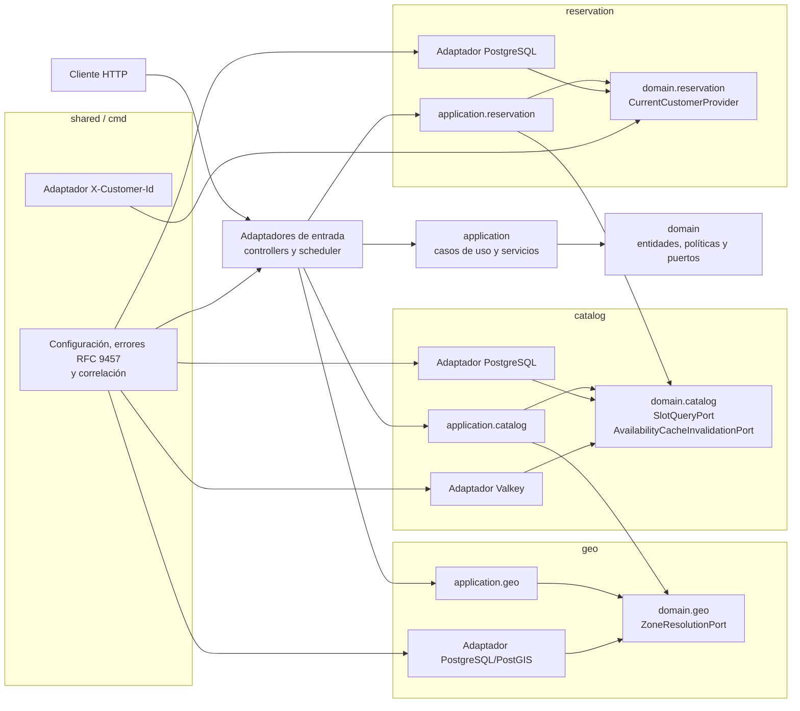
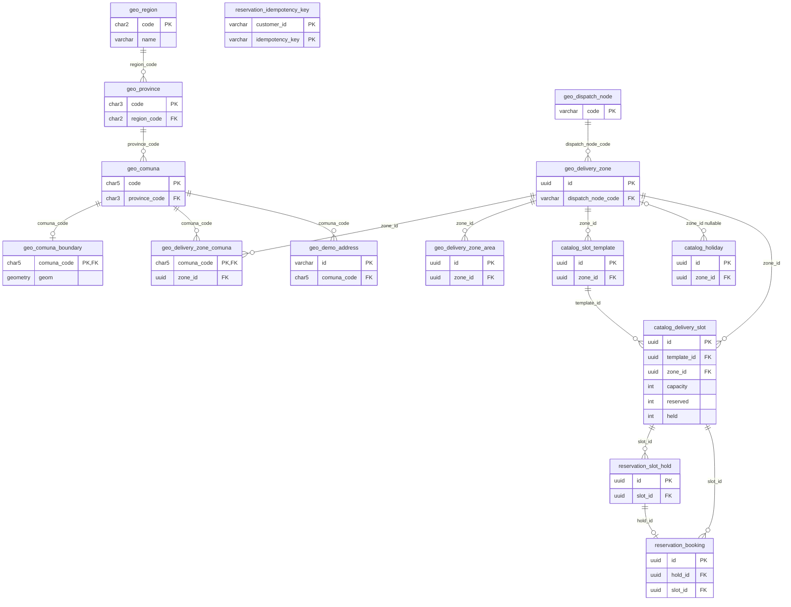
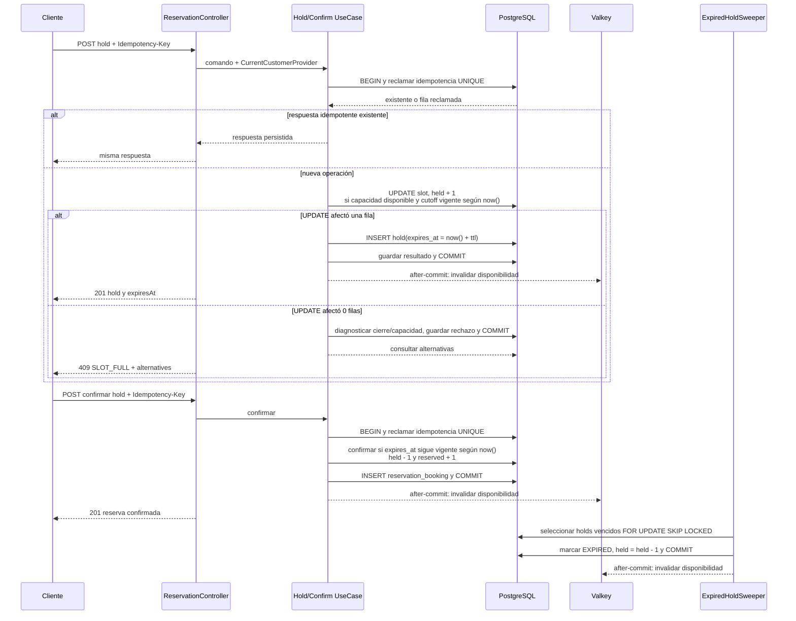

# Arquitectura de la API

Este documento describe la estructura que está implementada en la API. El contrato
HTTP está definido en `src/main/resources/openapi/openapi.yml`; PostgreSQL conserva
la fuente de verdad de la capacidad y Valkey solo acelera lecturas.

## Arquitectura hexagonal

Las dependencias avanzan desde los adaptadores hacia el dominio. `cmd` es la raíz de
composición compartida: configura los adaptadores sin convertirse en dependencia de
los contextos.

Los puertos mantienen explícitos los límites entre contextos: catálogo resuelve zonas
mediante `ZoneResolutionPort`; reservas consulta la ventana mediante `SlotQueryPort`
e invalida la disponibilidad por `AvailabilityCacheInvalidationPort`. La identidad
llega por `CurrentCustomerProvider`, no por el cuerpo del request.

## Modelo de entidades

V1 solamente habilita PostGIS. Las tablas mostradas abajo provienen de V2 (geo), V3
(catálogo) y V4 (reservas); los nombres de claves y relaciones corresponden a las
migraciones Flyway reales.

La última defensa de capacidad es el `CHECK`
`catalog_delivery_slot_capacity_check`: `reserved >= 0`, `held >= 0` y
`reserved + held <= capacity`. Las unicidades parciales también son parte del
modelo: `reservation_slot_hold_active_order_uq` impide más de una retención activa
por cliente y orden, y `reservation_booking_confirmed_order_uq` más de una reserva
confirmada por cliente y orden. Además, `reservation_booking_hold_unique` garantiza
una reserva por hold y la PK compuesta de `reservation_idempotency_key` reclama la
clave por cliente. `catalog_holiday.zone_id` puede ser `NULL` para representar un
feriado nacional; si tiene valor, el feriado se limita a esa zona.

## Secuencia retener → confirmar

El reloj autoritativo de las decisiones que cambian capacidad es `now()` de
PostgreSQL. La caché se invalida únicamente después de que la transacción se haya
confirmado, por lo que su indisponibilidad no puede alterar la capacidad.
La operación de retención es el `UPDATE` condicional `SET held = held + 1 WHERE
reserved + held < capacity AND cutoff_at > now()`; una fila afectada significa que
la capacidad se obtuvo y cero filas activa el diagnóstico para `SLOT_FULL`.

La secuencia resume las guardas de concurrencia. El detalle de columnas, estados y
restricciones está en las migraciones `V2_1__create_geo_schema.sql`,
`V3_1__create_catalog_schema.sql` y `V4_1__create_reservation_schema.sql`.
