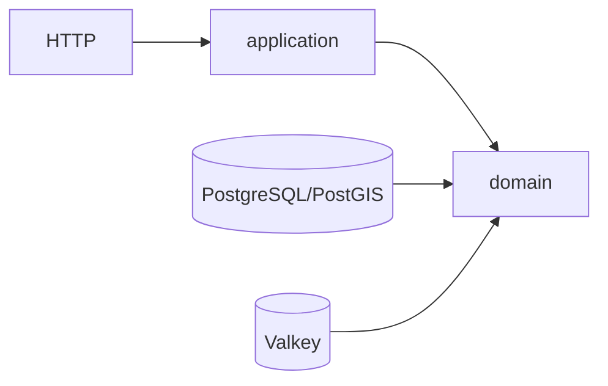

# 🧪 Pruebas, carga y arquitectura

[⬅️ Volver al README](../README.md)

| Alcance | Comando | Resultado esperado |
|---------|---------|--------------------|
| Unitarias | `./mvnw test` | Surefire verde |
| Todo | `./mvnw verify` | contrato, unitarias e integración/Testcontainers verdes |
| Concurrencia | `./mvnw verify -Dit.test=CapacityRaceIT` | sin sobre-reserva; también existen `ConfirmVersusExpiryRaceIT`, `IdempotentRetryRaceIT`, `ConcurrentSweeperIT` y `ConcurrentReleaseAndCancelIT` |
| Arquitectura | `./mvnw test -Dtest=ArchitectureRulesTest` | ArchUnit verde |
| Contrato | `npx @redocly/cli@2.62.1 lint src/main/resources/openapi/openapi.yml` | Redocly verde |
| Carga | `./load/run-flash-sale.sh` | 300 VUs por defecto y cero ventanas sobre capacidad |
| E2E web | `npm run e2e` en el [repositorio web](https://github.com/hugo-inda-toledo/walmart-cl-slot-reservation-website) | API local levantada como precondición |

El wrapper de carga elige una ventana real con cupo, ejecuta k6 y contrasta PostgreSQL. Su JSON vive en `load/results/flash-sale-summary.json` y no se versiona: cada ejecución muestra fecha, máquina, usuarios, cupo inicial, retenciones, confirmaciones, `SLOT_FULL`, p95 y `Ventanas sobre capacidad = 0`.

| Ejecución real | Resultado |
|---|---:|
| Fecha / máquina | 2026-10-13 / Darwin arm64 |
| Usuarios virtuales | 300 |
| Cupo inicial | 20 |
| Retenciones / confirmaciones | 20 / 20 |
| `SLOT_FULL` | 280 |
| p95 | 1430.42 ms |
| Ventanas sobre capacidad | 0 |

Consulte el [diagrama completo](arquitectura.md), el [modelo de entidades](arquitectura.md#modelo-de-entidades) y la [secuencia retener → confirmar](arquitectura.md#secuencia-retener--confirmar). Las decisiones se detallan en el [índice de ADRs](adr/README.md) y en el [documento de concurrencia](concurrencia-en-produccion.md): contrato primero, PostgreSQL como verdad, holds persistentes, Valkey acelerador, DPA/PostGIS, hexagonal/SOLID y Spring Boot 4.
